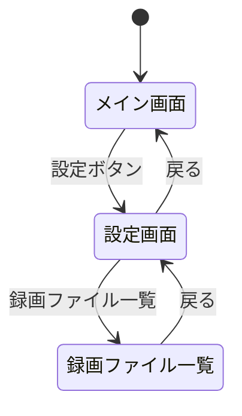
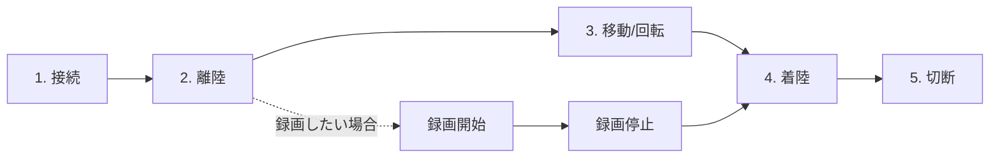

# TelloMove 操作説明書

| 項目 | 内容 |
|---|---|
| アプリ名 | TelloMove |
| バージョン | 1.0.2 |
| 対象ドローン | Ryze Tello |
| 対象 OS | Android 7.0 (API 24) 以降 |
| 文書版 | 1.0 |
| 更新日 | 2026-11-01 |

> 本ドキュメントは、TelloMove の操作方法を説明する**操作説明書**です。
> 機能仕様・設計・注意事項は以下のドキュメントを参照してください。
>
> - [機能仕様書](specification.md)
> - [概略設計書](abstract_design.md)
> - [詳細設計書](detailed_design.md)
> - [注意事項](notice.md)

---

## 1. アプリ紹介

TelloMove は、Ryze Tello ドローンを Android 端末から Wi-Fi（UDP）経由で制御する操作アプリケーションです。

主な機能：

- Tello への接続・切断
- 映像ストリームの受信（ライブビュー表示）
- 映像の録画
- 飛行制御（離陸・着陸・移動・回転・停止）
- 移動距離・回転角・速度の設定
- バッテリー残量の監視
- コマンドの音声発声（発声モード）
- 録画ファイルの一覧・削除・エクスポート（MP4 変換含む）

## 2. 動作環境・初期設定

### 2.1 必要なもの

- Ryze Tello（起動済み）
- Android 7.0 以降の端末
- Tello と同一の Wi-Fi 環境

### 2.2 初期設定の手順

1. **Tello を起動**する。
2. 端末の Wi-Fi で **Tello が提供するアクセスポイント**（または同一ネットワーク）に接続する。
3. **TelloMove アプリを起動**する。
4. 初回起動時に権限の要求が表示されるので、**すべて許可**する。
   - 権限を拒否するとアプリは起動できません。
5. メイン画面が表示されたら、準備完了です。

> 注: Tello の IP アドレスは既定 `192.168.10.1` です。

## 3. 画面構成

本アプリは 3 つの画面で構成されます。



| 画面 | 役割 |
|---|---|
| メイン画面 | ライブビュー、制御パッド、パラメータ設定、接続/映像/録画操作 |
| 設定画面 | Wi-Fi 設定、WatchDog、発声モード、ファイル一覧、説明、プライバシー |
| 録画ファイル一覧 | 録画ファイルの一覧・削除・エクスポート |

## 4. メイン画面の操作

メイン画面は上から順に、以下のパネルで構成されます。

```
┌─────────────────────────────┐
│  ライブビュー (映像 / ロゴ)    │
├─────────────────────────────┤
│  接続 / 映像 / 録画 / バッテリー │
│  制御パッド (離陸・着陸・移動等) │
├─────────────────────────────┤
│  パラメータ設定 (距離・角度・速度) │
├─────────────────────────────┤
│  設定 (設定画面へ)             │
└─────────────────────────────┘
```

### 4.1 ライブビュー

- 映像ストリームを受信中の場合、Tello の映像を表示します。
- 未受信の場合は Tello のロゴ画像を表示します。

### 4.2 接続 / 映像 / 録画 ボタン

| ボタン | 操作 | 送信コマンド |
|---|---|---|
| 接続 / 切断 | Tello への接続・切断 | `command` |
| 映像 | 映像ストリームの ON/OFF | `streamon` / `streamoff` |
| 録画 | 映像録画の開始 / 停止 | `rec_start` / `rec_stop` |
| バッテリー | バッテリー残量を表示（10 段階アイコン） | - |
| Wi-Fi | 端末の Wi-Fi 設定画面を開く | - |

> 注: 録画は「接続中」かつ「映像ストリーム受信中」の場合のみ可能です。

### 4.3 制御パッド

飛行制御を行うボタン群です。

| ボタン | 操作 | 送信コマンド |
|---|---|---|
| 離陸 | 離陸 | `takeoff` |
| 着陸 | 着陸 | `land` |
| 前 | 前方へ移動 | `forward <距離>` |
| 後 | 後方へ移動 | `back <距離>` |
| 左 | 左へ移動 | `left <距離>` |
| 右 | 右へ移動 | `right <距離>` |
| 上 | 上昇 | `up <距離>` |
| 下 | 下降 | `down <距離>` |
| CW | 右回転 | `cw <角度>` |
| CCW | 左回転 | `ccw <角度>` |
| 停止 | 緊急停止 | `stop` |

> 注: 移動距離・回転角は、パラメータ設定で指定した値が使用されます。

### 4.4 パラメータ設定

| パラメータ | 単位 | 範囲 | 既定値 |
|---|---|---|---|
| 移動距離 | cm | 20 – 500 | 50 |
| 回転角 | 度 | 1 – 360 | 90 |
| 速度 | cm/s | 10 – 100 | 20 |

- 速度は「設定」ボタンを押すことで `speed <値>` を送信します。
- 範囲外の値は自動的に範囲内に調整されます。

## 5. 基本操作フロー

Tello を操作する基本の流れは以下の通りです。



1. **接続**：「接続」ボタンで Tello に接続する。
2. **離陸**：「離陸」ボタンで Tello を離陸させる。
3. **移動・回転**：制御パッドで移動・回転させる。
4. **着陸**：「着陸」ボタンで Tello を着陸させる。
5. **切断**：「切断」ボタンで接続を解除する。

> 録画を行う場合は、離陸前に「映像」→「録画」の順で開始し、着陸後に「録画」→「映像」の順で停止します。

## 6. 設定画面の操作

メイン画面の「設定」ボタンから設定画面へ遷移します。

| 項目 | 説明 |
|---|---|
| 戻る | メイン画面へ戻る |
| Wi-Fi 設定 | 端末の Wi-Fi 設定画面を開く |
| 周期的にコマンド送信（WatchDog） | 接続中に周期的に `battery?` を送信しバッテリーを監視。既定: 有効。**再起動後に有効化**。 |
| コマンドを発声（発声モード） | コマンドを Tello に送信せず音声で読み上げる。既定: 無効。 |
| 録画ファイル一覧 | 録画ファイル一覧画面へ遷移 |
| 操作説明 | 本操作説明書（GitHub）を開く |
| プライバシーポリシー | プライバシーポリシー（GitHub）を開く |

## 7. 録画ファイル一覧の操作

設定画面の「録画ファイル一覧」から遷移します。

| 操作 | 説明 |
|---|---|
| 一覧表示 | 録画ファイル（`.h264`）の一覧を表示 |
| 全削除 | 全ファイルを削除（確認ダイアログあり） |
| ファイル削除 | 選択ファイルを削除（確認ダイアログあり） |
| ファイルエクスポート | 選択ファイルを MediaStore（`Movies/TelloMove/`）へ書き出す |
| MP4 ファイルエクスポート | 選択ファイルを MP4 へ変換して MediaStore へ書き出す |

> 注: 録画ファイルは生 H.264 NAL データです。再生・共有には「MP4 ファイルエクスポート」または外部ツール（FFmpeg 等）での変換が必要です。

## 8. コマンド対応表

| 操作 | 送信コマンド |
|---|---|
| 接続 / 切断 | `command` |
| 映像 ON | `streamon` |
| 映像 OFF | `streamoff` |
| 録画開始 | `rec_start` |
| 録画停止 | `rec_stop` |
| 離陸 | `takeoff` |
| 着陸 | `land` |
| 前方移動 | `forward <距離>` |
| 後方移動 | `back <距離>` |
| 左移動 | `left <距離>` |
| 右移動 | `right <距離>` |
| 上昇 | `up <距離>` |
| 下降 | `down <距離>` |
| 右回転 | `cw <角度>` |
| 左回転 | `ccw <角度>` |
| 停止 | `stop` |
| 速度設定 | `speed <速度>` |
| バッテリー確認 | `battery?` |

## 9. よくある質問・トラブルシューティング

| 質問・症状 | 対処 |
|---|---|
| 接続できない | Tello と同一 Wi-Fi であること、Tello が起動中であることを確認。Wi-Fi 設定を確認。 |
| 映像が表示されない | 接続中か、映像ストリームが ON であるかを確認。 |
| コマンドが応答しない | Wi-Fi の安定性、Tello のバッテリー残量を確認。 |
| 録画ファイルが再生できない | 「MP4 ファイルエクスポート」を行う、または ffmpeg 等で変換する。 |
| 発声されない | 日本語 TTS が利用可能か、発声モードが有効かを確認。 |
| バッテリーが表示されない | WatchDog が有効か、接続中かを確認。 |
| 発声モードで Tello が動かない | 発声モードではコマンドは送信されません。発声のみ行います。 |

## 10. 安全上の注意

- Tello は飛行体です。周囲に人・動物・障害物がないことを確認のうえ操作してください。
- 常に Tello の位置を視認してください。
- バッテリー残量が少ない状態で飛行を続けると、急降下・墜落の恐れがあります。
- 異常が確認された場合は速やかに「停止」または「着陸」を行ってください。
- 本アプリの使用に伴う一切の事故・損害について、開発者は責任を負いません。

> 詳細な注意事項は [注意事項](notice.md) を参照してください。
