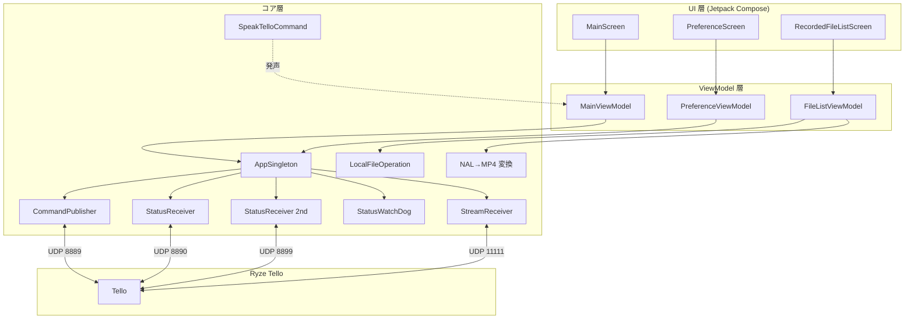
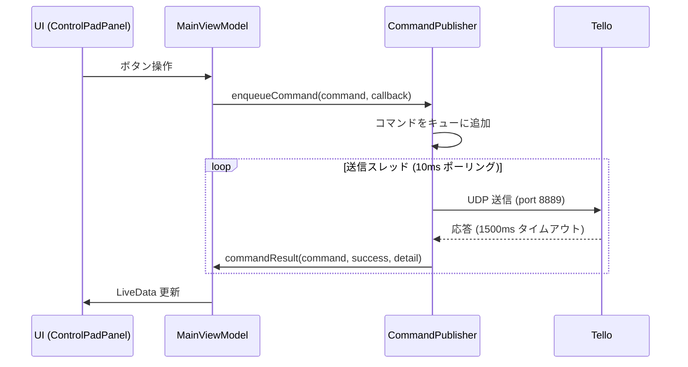
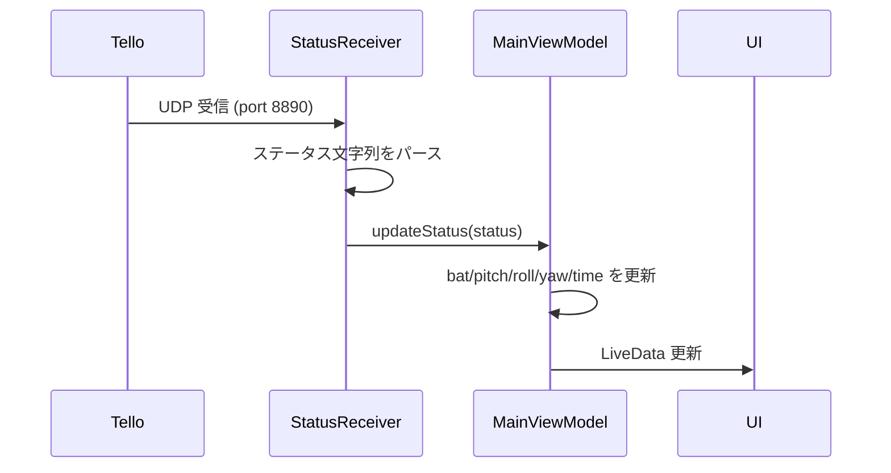
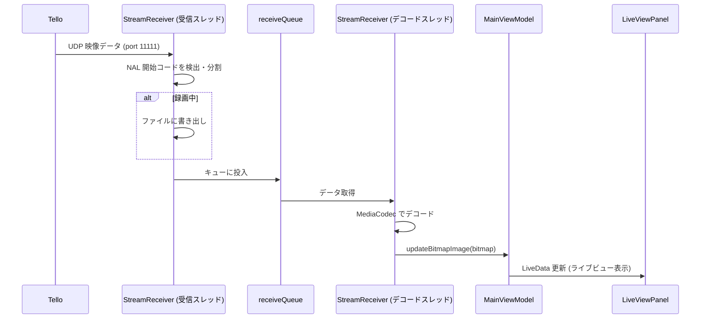
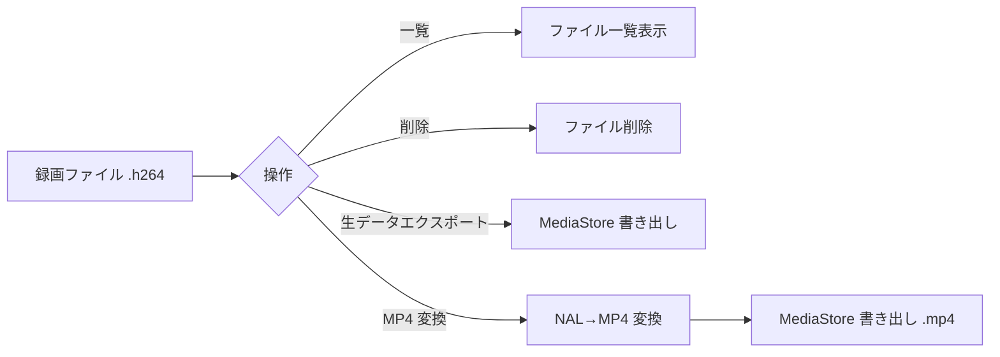
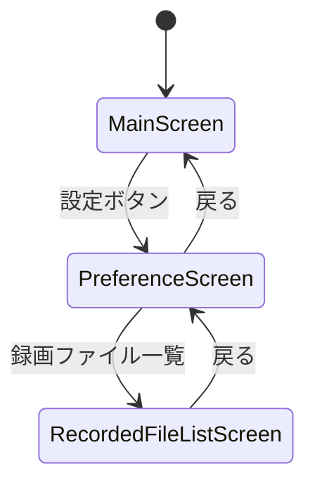

# TelloMove 概略設計書

| 項目 | 内容 |
|---|---|
| アプリ名 | TelloMove |
| パッケージ名 | `jp.osdn.gokigen.tellomove` |
| バージョン | 1.0.2 |
| 文書版 | 1.0 |
| 更新日 | 2026-11-01 |

---

## 1. 設計方針

本アプリは、以下の設計方針に基づいて構成される。

- **MVVM アーキテクチャ**：UI（Compose）とロジック（ViewModel）を分離。
- **Jetpack Compose + Material3**：UI を宣言的に記述。
- **UDP 通信**：Tello との通信は UDP（コマンド / ステータス / 映像ストリーム）を使用。
- **スレッド分離**：UDP 受信・映像デコード・コマンド送信をそれぞれ独立スレッドで処理。
- **シングルトン管理**：通信系コンポーネントを `AppSingleton`（`Application`）で一括管理。
- **LiveData による状態通知**：ViewModel が UI へ状態を非同期通知。

## 2. 全体構成

### 2.1 層構成



### 2.2 層の責務

| 層 | 責務 |
|---|---|
| UI 層 | 画面表示、ユーザー操作の受付、ViewModel への委譲 |
| ViewModel 層 | 状態管理（LiveData）、UI とコア層の仲介 |
| コア層 | 通信、映像処理、ファイル操作、音声発声 |
| Tello | コマンド応答、ステータス通知、映像ストリーム送信 |

## 3. モジュール構成

### 3.1 パッケージ構成

```
jp.osdn.gokigen.tellomove
├── AppSingleton.kt          # Application、通信系コンポーネントの管理
├── MainActivity.kt          # エントリポイント、権限要求、ViewModel 初期化
├── communication/           # 通信系
│   ├── CommandPublisher.kt  # コマンド送信 (UDP 8889)
│   ├── StatusReceiver.kt    # ステータス受信 (UDP 8890/8899)
│   ├── StatusWatchDog.kt    # 周期的コマンド送信・バッテリー監視
│   ├── StreamReceiver.kt    # 映像ストリーム受信・デコード・録画 (UDP 11111)
│   ├── TelloCommand.kt      # コマンドデータクラス
│   ├── ICommandPublisher.kt # コマンド送信インターフェース
│   ├── ICommandResult.kt    # コマンド結果コールバック
│   ├── IStatusUpdate.kt     # ステータス更新コールバック
│   ├── IConnectionStatusUpdate.kt
│   ├── IBitmapReceiver.kt   # ビットマップ受信コールバック
│   ├── TelloCommandCallback.kt
│   └── TelloConnectionCallback.kt
├── file/                    # ファイル操作系
│   ├── LocalFileOperation.kt    # ファイル一覧・削除
│   ├── NALToMP4Converter2.kt    # NAL→MP4 変換 (使用)
│   ├── ExportMovieFile.kt       # 生データエクスポート
│   └── IFileOperationNotify.kt  # ファイル操作通知
├── preference/              # 設定系
│   └── IPreferencePropertyAccessor.kt  # 設定キー・既定値
├── speakcommand/            # 音声発声系
│   ├── SpeakTelloCommand.kt       # TTS によるコマンド発声
│   └── ISpeakCommandStatusUpdate.kt
└── ui/
    ├── model/               # ViewModel
    │   ├── MainViewModel.kt
    │   ├── PreferenceViewModel.kt
    │   └── FileListViewModel.kt
    ├── view/                # Compose UI
    │   ├── ViewRootComponent.kt   # ルート・ナビゲーション
    │   ├── MainScreen.kt
    │   ├── ControlPadPanel.kt
    │   ├── LiveViewPanel.kt
    │   ├── SetParameterLayout.kt
    │   ├── PreferenceScreen.kt
    │   ├── RecordedFileListScreen.kt
    │   └── FilerCommandPanel.kt
    └── theme/               # テーマ
        ├── Color.kt
        ├── Theme.kt
        └── Type.kt
```

### 3.2 モジュールの責務

| モジュール | 責務 |
|---|---|
| `AppSingleton` | 通信系コンポーネントの生成・起動・停止を一元管理 |
| `MainActivity` | アプリ起動、権限要求、ViewModel 初期化、ルートビュー設定 |
| `communication` | Tello へのコマンド送信、ステータス/映像受信、バッテリー監視 |
| `file` | 録画ファイルの保存・一覧・削除・エクスポート・MP4 変換 |
| `preference` | 設定キーと既定値の定義 |
| `speakcommand` | コマンドの音声発声（TTS） |
| `ui.model` | UI 状態の管理（LiveData）、UI とコア層の仲介 |
| `ui.view` | 画面表示、ユーザー操作の受付 |

## 4. 通信設計

### 4.1 通信ポート

| 用途 | ポート | 方向 |
|---|---|---|
| コマンド送信 | `8889` | アプリ → Tello |
| ステータス受信 | `8890` | Tello → アプリ |
| ステータス受信（2nd） | `8899` | Tello → アプリ |
| 映像ストリーム | `11111` | Tello → アプリ |

### 4.2 コマンド送信フロー



### 4.3 ステータス受信フロー



### 4.4 映像ストリーム受信フロー



## 5. スレッド・並行設計

| スレッド | 生成元 | 責務 |
|---|---|---|
| コマンド送信スレッド | `CommandPublisher.start()` | キューからコマンドを取り出して UDP 送信 |
| ステータス受信スレッド | `StatusReceiver.startReceive()` | UDP 8890/8899 のステータス受信 |
| 映像受信スレッド | `StreamReceiver.startReceive()` | UDP 11111 の映像データ受信・分割 |
| 映像デコードスレッド | `StreamReceiver.startReceive()` | MediaCodec による映像デコード |
| WatchDog スレッド | `StatusWatchDog.startWatchDog()` | 周期的に `battery?` を送信 |
| ファイル操作スレッド | `LocalFileOperation` / 変換 | エクスポート・MP4 変換 |

### 5.1 並行制御

- **コマンドキュー**：`ArrayDeque`（`CommandPublisher`）で FIFO 管理。
- **映像キュー**：`ArrayBlockingQueue<ByteArray>(100)`（`StreamReceiver`）で受信とデコードを分離。
- **UI 更新**：`CoroutineScope(Dispatchers.Main)` で LiveData をメインスレッドで更新。

## 6. データフロー

### 6.1 映像データフロー

```mermaid
flowchart LR
    A[UDP 映像データ] --> B[NAL 開始コード検出]
    B --> C{録画中?}
    C -->|Yes| D[ファイル書き出し .h264]
    C -->|No| E[receiveQueue]
    B --> E
    E --> F[MediaCodec デコード]
    F --> G[YUV→Bitmap 色変換 (I420/NV12/NV21)]
    G --> H[LiveData]
    H --> I[ライブビュー表示]
```

### 6.2 ファイルデータフロー



## 7. 状態管理設計

### 7.1 ViewModel と LiveData

| ViewModel | 主な LiveData |
|---|---|
| `MainViewModel` | `isTelloConnected`, `isVideoStreamOn`, `isVideoRecordingOn`, `informationMessage`, `statusMessage`, `moveDistanceCm`, `moveDegree`, `moveSpeed`, `batteryPercent`, `motorRunningTime`, `pitch`, `roll`, `yaw`, `imageBitmap`, `speakCommands` |
| `PreferenceViewModel` | `useWatchdog`, `speakCommands` |
| `FileListViewModel` | `fileNameList`, `selectedFileName`, `processExecuting`, `exportImageBitmap` |

### 7.2 状態の更新経路

```mermaid
flowchart LR
    A[コア層イベント] --> B[コールバック]
    B --> C[ViewModel]
    C --> D[LiveData]
    D --> E[UI (observeAsState)]
```

## 8. 画面遷移設計



| 画面 | 役割 |
|---|---|
| `MainScreen` | ライブビュー、制御パッド、パラメータ設定、接続/映像/録画操作 |
| `PreferenceScreen` | 設定（Wi-Fi / WatchDog / 発声 / ファイル一覧 / 説明 / プライバシー） |
| `RecordedFileListScreen` | 録画ファイルの一覧・削除・エクスポート |

## 9. 技術スタック

| 項目 | 技術 |
|---|---|
| 言語 | Kotlin |
| UI | Jetpack Compose + Material3 |
| ナビゲーション | Navigation Compose |
| 状態管理 | ViewModel + LiveData |
| 通信 | UDP (`DatagramSocket`) |
| 映像デコード | `MediaCodec` (H.264/AVC) |
| 音声発声 | `TextToSpeech` (TTS) |
| ファイル | `File` / `MediaStore` |
| 最低 SDK | 24 (Android 7.0) |
| ターゲット SDK | 37 |
