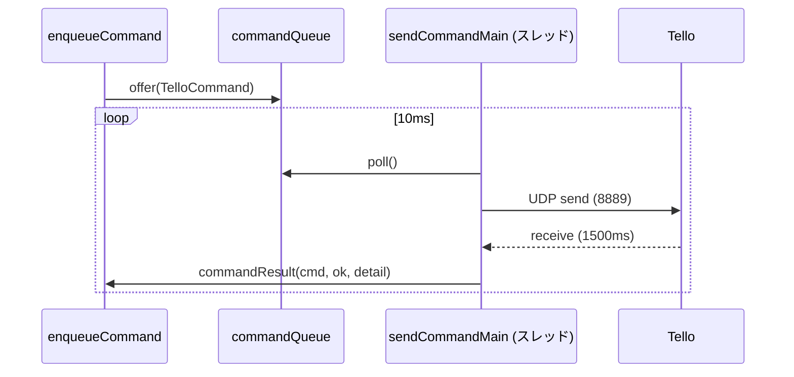
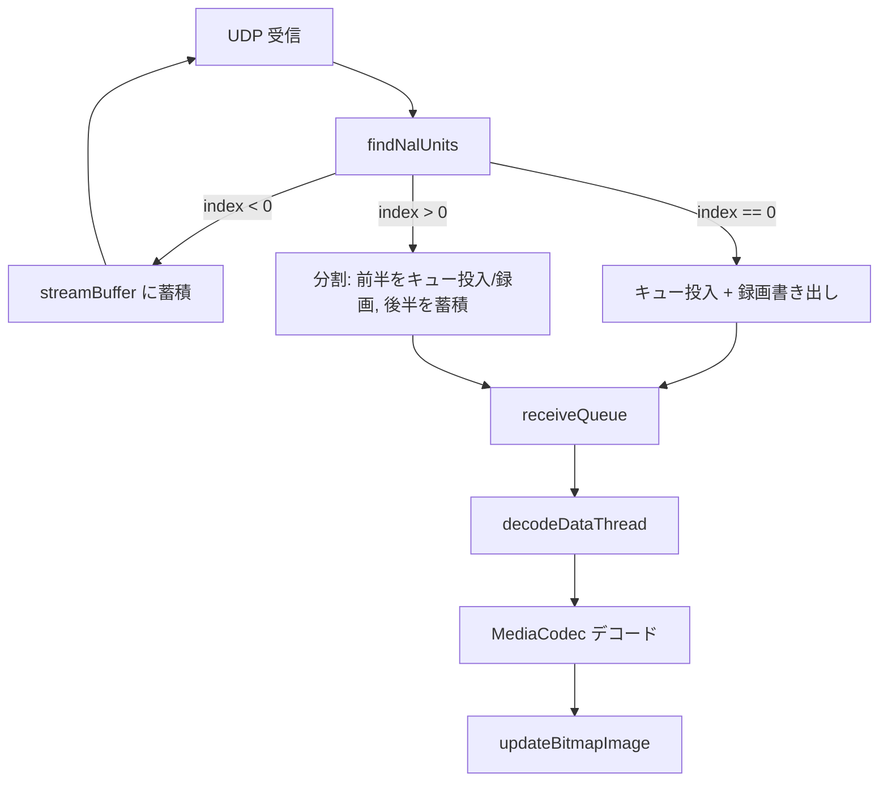
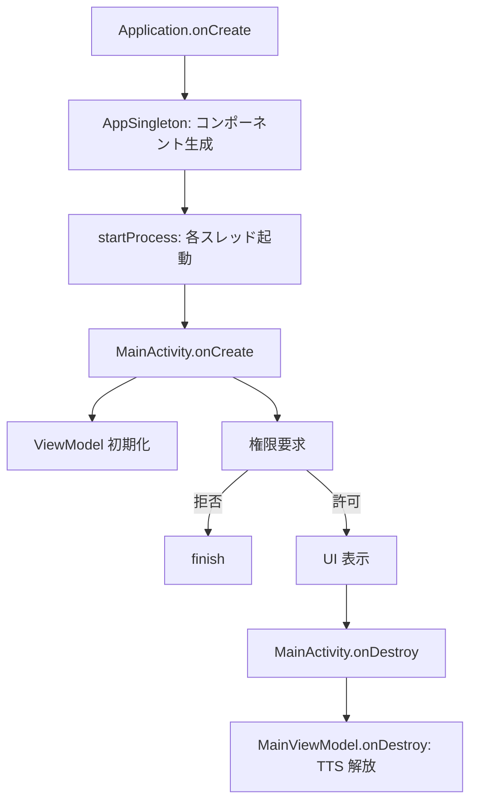

# TelloMove 詳細設計書

| 項目 | 内容 |
|---|---|
| アプリ名 | TelloMove |
| パッケージ名 | `jp.osdn.gokigen.tellomove` |
| バージョン | 1.0.2 |
| 文書版 | 1.0 |
| 更新日 | 2026-11-01 |

> 本ドキュメントは、クラス・関数・定数レベルの詳細設計を記述する。概略は `abstract_design.md`、機能仕様は `specification.md` を参照。

---

## 1. エントリポイント

### 1.1 `AppSingleton`（`Application`）

アプリ起動時に通信系コンポーネントを生成・起動するシングルトン。

| 項目 | 内容 |
|---|---|
| 生成コンポーネント | `publisher`, `receiver`, `receiver2nd`, `streamReceiver`, `watchdog`, `starter` |
| 起動 | `startProcess()`（`onCreate` で呼ばれる） |
| 停止 | `onTerminate` で各 `stop` を呼ぶ |

```kotlin
class AppSingleton : Application() {
    // companion object 内の static 参照
    lateinit var publisher: CommandPublisher
    lateinit var receiver: StatusReceiver        // port 8890
    lateinit var receiver2nd: StatusReceiver     // port 8899
    lateinit var streamReceiver: StreamReceiver  // port 11111
    lateinit var watchdog: StatusWatchDog
    lateinit var starter: ProcessStarter
    private const val WAIT_MS = 25L
}
```

- `ProcessStarter.start()`：`startProcess()` を呼ぶラッパー。UI から `AppSingleton.starter.start()` で起動。
- `startProcess()`：`isInitialized` が false の場合のみ各コンポーネントを起動し、`Thread.sleep(WAIT_MS)`。

### 1.2 `MainActivity`

| 項目 | 内容 |
|---|---|
| 役割 | 権限要求、ViewModel 初期化、ルートビュー設定 |
| 権限 | `VIBRATE`, `INTERNET`, `ACCESS_NETWORK_STATE`, `ACCESS_WIFI_STATE`, `CHANGE_WIFI_MULTICAST_STATE` |
| 画面 | `FLAG_KEEP_SCREEN_ON`、`supportActionBar?.hide()` |

主要処理：

1. `enableEdgeToEdge()`
2. `MainViewModel` / `PreferenceViewModel` / `FileListViewModel` を `ViewModelProvider` で生成し `initializeViewModel` を呼ぶ。
3. `ViewRootComponent` を生成し `prepare(...)`、`setContent { rootComponent.Content() }`。
4. 権限チェック（`allPermissionsGranted()`）。未付与なら `RequestMultiplePermissions` で要求、拒否時は `finish()`。

> 注: `ACCESS_MEDIA_LOCATION` は API 29 未満ではチェックから除外される。

## 2. 通信層（`communication`）

### 2.1 `CommandPublisher`

Tello へのコマンド送信（UDP）。

| 項目 | 値 |
|---|---|
| 既定 IP | `192.168.10.1` |
| 既定ポート | `8889` |
| 受信バッファ | `BUFFER_SIZE = 384 * 1024 + 16`（約 384KB） |
| キューポーリング間隔 | `COMMAND_POLL_QUEUE_MS = 10`（ms） |
| 送信タイムアウト | `COMMAND_SEND_TIMEOUT_MS = 1500`（ms） |

主要メソッド：

| メソッド | 説明 |
|---|---|
| `enqueueCommand(command, callback)` | コマンドを `commandQueue`（`ArrayDeque`）に追加。`callback.queuedCommand` を呼ぶ。 |
| `start()` | 送信スレッドを起動し `sendCommandMain()` を実行。 |
| `sendCommandMain()` | ループでキューから取り出し、UDP 送信 → 応答受信（1500ms タイムアウト）→ `callback.commandResult`。 |
| `stop()` | `isStarted = false` でスレッド終了。 |
| `setConnectionStatus(status)` | 接続状態を保持。 |
| `isConnected()` | 接続状態を返す。 |

送信フロー：



### 2.2 `StatusReceiver`

Tello からステータスを UDP 受信。

| 項目 | 値 |
|---|---|
| 既定ポート | `8890`（2nd は `8899`） |
| 受信バッファ | `BUFFER_SIZE = 256 * 1024 + 16`（約 256KB） |
| 受信タイムアウト | `TIMEOUT_MS = 5500`（ms） |

主要メソッド：

| メソッド | 説明 |
|---|---|
| `startReceive()` | 受信スレッドを起動。 |
| `checkReceiveData(packet)` | 受信データを文字列化し `statusUpdateReport.updateStatus` を呼ぶ。 |
| `stopReceive()` | `isReceiving = false`。 |
| `setStatusUpdateReport(target)` | 受信先（`IStatusUpdate`）を設定。 |

### 2.3 `StatusWatchDog`

接続中に周期的に `battery?` を送信し、バッテリー残量を取得。

| 項目 | 値 |
|---|---|
| 送信間隔 | `WAIT_LIMIT = 12 * 1000`（12 秒） |
| 送信条件 | `publisher.isConnected()` が true の場合のみ |

主要メソッド：

| メソッド | 説明 |
|---|---|
| `startWatchDog()` | スレッドを起動し、12 秒間隔で `battery?` を送信。 |
| `stopWatchDog()` | `isStarted = false`。 |
| `setUseWatchdog(isUse)` | 有効/無効を切替。 |
| `setReportBatteryStatus(target)` | バッテリー報告先（`IStatusUpdate`）を設定。 |

### 2.4 `StreamReceiver`

映像ストリームの受信・分割・デコード・録画。

| 項目 | 値 |
|---|---|
| 既定ポート | `STREAM_PORT = 11111` |
| 映像サイズ | `VIDEO_WIDTH = 960`, `VIDEO_HEIGHT = 720` |
| 受信キュー | `ArrayBlockingQueue<ByteArray>(100)` |
| 録画ファイル名 | `M` + `yyyyMMdd_HHmmss` + `_0.h264`（`FILENAME_FORMAT = "yyyyMMdd_HHmmss"`） |
| 保存先 | `getExternalFilesDir()/TelloMove/` |
| 色変換 | I420 / NV12 / NV21 対応（`KEY_COLOR_FORMAT` 自動判定、既定 NV21） |

主要メソッド：

| メソッド | 説明 |
|---|---|
| `startReceive()` | 受信スレッドとデコードスレッドを起動。 |
| `stopReceive()` | `running = false`、デコーダ解放。 |
| `prepareFileOutputDirectory(context)` | 録画出力ディレクトリを準備。 |
| `changeRecordingStreamStatus(onOff)` | 録画開始（ファイル作成）/停止（クローズ）。 |
| `receiveUdpDataThread(port)` | UDP 受信、NAL 開始コード検出で分割、録画時はファイル書き出し、キュー投入。 |
| `findNalUnits(data)` | 開始コード（`00 00 00 01` / `00 00 01`）の位置を検出。 |
| `initializeDecoder()` | `MediaCodec`（H.264/AVC）を初期化。 |
| `decodeDataThread()` | キューから取得しデコード、`IBitmapReceiver.updateBitmapImage` を呼ぶ。 |
| `yuv420ToBitmap(yuvBytes, width, height, colorFormat)` | YUV データを Bitmap へ変換。`colorFormat`（I420 / NV12 / NV21）に応じて U/V プレーンのオフセットを切り替える。 |

> **色変換について**：`decodeDataThread()` は `decoder.outputFormat` の `KEY_COLOR_FORMAT` を取得し、`yuv420ToBitmap` に渡す。取得失敗時は NV21（SemiPlanar）を既定とする。
> - **I420（Planar）**：Y / U / V が独立したプレーン。
> - **NV12 / NV21（SemiPlanar）**：U と V が交互に配置（NV21 は V が先、NV12 は U が先）。
> 実機で色ずれが残る場合は、`KEY_COLOR_FORMAT` の実値を確認のうえ NV12（U が先）の分岐を追加すること。

映像処理フロー：



### 2.5 コールバック・データクラス

| クラス | 役割 |
|---|---|
| `TelloCommand` | `data class TelloCommand(command: String, callback: ICommandResult?)` |
| `ICommandPublisher` | `enqueueCommand`, `isConnected` |
| `ICommandResult` | `queuedCommand(command)`, `commandResult(command, success, detail)` |
| `IStatusUpdate` | `updateStatus`, `updateBatteryRemain`, `updateCommandStatus` 等 |
| `IConnectionStatusUpdate` | `queuedConnectionCommand`, `setConnectionStatus` |
| `IBitmapReceiver` | `updateBitmapImage(bitmap)` |
| `TelloCommandCallback` | `ICommandResult` 実装。`detail.contains("ok")` で成功判定し `updateCommandStatus` を呼ぶ。 |
| `TelloConnectionCallback` | `ICommandResult` 実装。`detail.contains("ok")` で接続判定し `setConnectionStatus` を呼ぶ。 |

## 3. ファイル層（`file`）

### 3.1 `LocalFileOperation`

録画ファイルの一覧・削除。

| メソッド | 説明 |
|---|---|
| `getFileList(topDir)` | `getExternalFilesDir()/TelloMove/` のファイル一覧を返す。 |
| `cleanupAllFiles(topDir)` | ディレクトリ配下を再帰削除。 |
| `deleteFile(fileName)` | 指定ファイルを削除。 |

> 生データエクスポートは `ExportMovieFile.exportBinaryFileExternal`、MP4 変換エクスポートは `FileListViewModel.exportAsMP4File`（`NALToMP4Converter2` 使用）で行う。

### 3.2 NAL→MP4 変換

| クラス | 説明 |
|---|---|
| `NALToMP4Converter2` | NAL→MP4 変換（**使用**）。`convertNALToMp4(inputFileName, outputFileName, bitmapNotify)`。 |

`NALToMP4Converter2` の主要要素：

| 項目 | 内容 |
|---|---|
| デコード/エンコード | `MediaCodec`（decoder / encoder） |
| マルチプレックス | `MediaMuxer` |
| フレームキュー | `decodedFramesQueue`（`ArrayBlockingQueue(10)`）, `frameTimestampsQueue`（`ArrayBlockingQueue(10)`） |
| 出力 | MediaStore（`Movies/TelloMove/`）, `video/mp4` |
| 進捗通知 | `IBitmapReceiver.updateBitmapImage` でフレームを通知 |

### 3.3 `IFileOperationNotify`

| メソッド | 説明 |
|---|---|
| `onCompletedExport(result, fileName)` | エクスポート完了を通知。 |

## 4. 設定層（`preference`）

### 4.1 `IPreferencePropertyAccessor`

| キー | 既定値 |
|---|---|
| `PREFERENCE_USE_WATCHDOG = "use_watchdog"` | `true` |
| `PREFERENCE_SPEAK_COMMANDS = "speak_commands"` | `false` |

## 5. 音声発声層（`speakcommand`）

### 5.1 `SpeakTelloCommand`

| 項目 | 内容 |
|---|---|
| 言語 | `Locale.JAPAN` |
| 初期化 | `TextToSpeech.OnInitListener`。日本語利用可否を確認。 |
| 発声 | `speakTelloCommand(command)` → キーワード変換 → `speakText` |
| キュー | `TextToSpeech.QUEUE_FLUSH` |

主要メソッド：

| メソッド | 説明 |
|---|---|
| `onInit(status)` | TTS 初期化、日本語設定、`callback.speechEngineInitialized`。 |
| `speakTelloCommand(command)` | コマンドを日本語キーワードに変換して発声。 |
| `decideKeywordString(command)` | 移動系コマンド（`up/down/left/right/forward/back/cw/ccw`）を値に応じて変換。 |
| `speakText(text)` | `textToSpeech.speak`。 |
| `onDestroy()` | `textToSpeech.shutdown()`。 |

### 5.2 `ISpeakCommandStatusUpdate`

| メソッド | 説明 |
|---|---|
| `speechEngineInitialized(status)` | TTS 初期化状態を通知。 |
| `setSpeakCommandStatus(isEnable)` | 発声モード切替を通知。 |

## 6. ViewModel 層（`ui.model`）

### 6.1 `MainViewModel`

`IConnectionStatusUpdate`, `ISpeakCommandStatusUpdate`, `IStatusUpdate`, `IBitmapReceiver` を実装。

| LiveData | 型 | 説明 |
|---|---|---|
| `isTelloConnected` | `Boolean` | 接続状態 |
| `speakCommands` | `Boolean` | 発声モード |
| `isVideoStreamOn` | `Boolean` | 映像ストリーム状態 |
| `isVideoRecordingOn` | `Boolean` | 録画状態 |
| `informationMessage` | `String` | 情報メッセージ |
| `statusMessage` | `String` | ステータスメッセージ |
| `moveDistanceCm` | `Int` | 移動距離（既定 50） |
| `moveDegree` | `Int` | 回転角（既定 90） |
| `moveSpeed` | `Int` | 速度（既定 20） |
| `batteryPercent` | `Int` | バッテリー残量（既定 -1） |
| `motorRunningTime` | `Int` | モーター稼働時間（既定 0） |
| `pitch` / `roll` / `yaw` | `Int` | 姿勢角（既定 0） |
| `imageBitmap` | `Bitmap` | 映像ビットマップ |

主要メソッド：

| メソッド | 説明 |
|---|---|
| `initializeViewModel(activity)` | 初期値設定、TTS 生成、イベント購読、録画ディレクトリ準備。 |
| `setDistance/setDegree/setSpeed` | パラメータ更新。 |
| `parseStatusInformation(status)` | `;` で分割し `bat/pitch/roll/yaw/time` をパース。 |
| `setVideoRecordingMode(isRecording)` | 録画開始/停止（`streamReceiver.changeRecordingStreamStatus`）。 |
| `updateStatus(status)` | ステータス更新、接続状態 true。 |
| `updateCommandStatus(command, success, detail)` | コマンド結果更新（`streamon/streamoff` で映像状態切替）。 |
| `updateBatteryRemain(percentage)` | バッテリー残量更新。 |
| `updateBitmapImage(bitmap)` | 映像ビットマップ更新。 |
| `doSpeakCommand(command)` | TTS で発声。 |
| `onDestroy()` | TTS 解放。 |

ステータスパース例：

```
bat:85;pitch:0;roll:0;yaw:0;...;time:120;...
```

- `bat` → `batteryPercent`
- `pitch` / `roll` / `yaw` → 姿勢角
- `time` → `motorRunningTime`

### 6.2 `PreferenceViewModel`

| LiveData | 説明 |
|---|---|
| `useWatchdog` | WatchDog 有効/無効 |
| `speakCommands` | 発声モード有効/無効 |

主要メソッド：

| メソッド | 説明 |
|---|---|
| `initializeViewModel(activity, speakStatusUpdate)` | 設定読み込み、発声コールバック設定。 |
| `setUseWatchDog(value)` | 設定保存、LiveData 更新。 |
| `setSpeakCommand(value)` | 設定保存、LiveData 更新、`speakCommandsCallback.setSpeakCommandStatus`。 |

### 6.3 `FileListViewModel`

| LiveData | 説明 |
|---|---|
| `fileNameList` | ファイル一覧 |
| `selectedFileName` | 選択ファイル名 |
| `processExecuting` | 処理実行中 |
| `exportImageBitmap` | エクスポート進捗ビットマップ |

主要メソッド：

| メソッド | 説明 |
|---|---|
| `initializeViewModel(activity)` | `LocalFileOperation` 生成、ファイル一覧取得。 |
| `updateFileNameList()` | ファイル一覧を更新。 |
| `selectedFileName(fileName)` | 選択ファイルを設定。 |
| `deleteFileName(fileName)` | ファイル削除。 |
| `exportAsMP4File(context, fileName, callback)` | `NALToMP4Converter2` で MP4 変換エクスポート。 |
| `exportMovieFile(context, fileName, callback)` | 生データエクスポート。 |

## 7. UI 層（`ui.view`）

### 7.1 `ViewRootComponent`

`AbstractComposeView` 実装。`NavHost` で 3 画面を管理。

| ルート | 画面 |
|---|---|
| `MainScreen` | メイン画面（startDestination） |
| `PreferenceScreen` | 設定画面 |
| `RecordedFileListScreen` | 録画ファイル一覧画面 |

### 7.2 `MainScreen`

構成（上から順）：

1. `LiveViewPanel` — ライブビュー / Tello ロゴ
2. `ControlPadPanel` — 接続/映像/録画/制御パッド
3. `SetParameterLayout` — パラメータ設定
4. `BottomCommandPanel` — 設定画面遷移

### 7.3 `ControlPadPanel`

- 接続/切断ボタン（`command`）
- 映像ストリームボタン（`streamon`/`streamoff`）
- 録画ボタン（`rec_start`/`rec_stop`）
- バッテリーアイコン（残量 10 段階）
- Wi-Fi 設定ボタン
- 制御パッド（離陸/着陸/前後左右/上下/CW/CCW/停止）

クランプ処理：

| パラメータ | クランプ範囲 |
|---|---|
| 移動距離 | 20 – 500 |
| 回転角 | 1 – 360 |

### 7.4 `SetParameterLayout`

- 移動距離（cm）入力
- 回転角（度）入力
- 速度（cm/s）入力 + 「設定」ボタン（`speed <値>`、クランプ 10–100）
- ステータスメッセージ表示

### 7.5 `PreferenceScreen`

- 戻る
- Wi-Fi 設定
- WatchDog 切替
- 発声モード切替
- 録画ファイル一覧
- 操作説明（GitHub）
- プライバシーポリシー（GitHub）

### 7.6 `RecordedFileListScreen` / `FilerCommandPanel`

- ファイル一覧（`LazyColumn`）
- 全削除 / 単体削除 / 生データエクスポート / MP4 変換エクスポート（確認ダイアログ）

## 8. 定数・既定値一覧

| 定数 | 値 | 定義箇所 |
|---|---|---|
| Tello IP | `192.168.10.1` | `CommandPublisher` |
| コマンドポート | `8889` | `CommandPublisher` |
| ステータスポート | `8890` / `8899` | `StatusReceiver` |
| 映像ポート | `11111` | `StreamReceiver` |
| 映像サイズ | `960 x 720` | `StreamReceiver` |
| コマンド送信タイムアウト | `1500` ms | `CommandPublisher` |
| コマンドポーリング間隔 | `10` ms | `CommandPublisher` |
| コマンド受信バッファ | `384KB + 16` | `CommandPublisher` |
| ステータス受信バッファ | `256KB + 16` | `StatusReceiver` |
| ステータス受信タイムアウト | `5500` ms | `StatusReceiver` |
| WatchDog 間隔 | `12000` ms | `StatusWatchDog` |
| 録画ファイル名 | `M` + `yyyyMMdd_HHmmss` + `_0.h264` | `StreamReceiver` |
| 移動距離既定 | `50` cm | `MainViewModel` |
| 回転角既定 | `90` 度 | `MainViewModel` |
| 速度既定 | `20` cm/s | `MainViewModel` |
| 移動距離範囲 | `20 – 500` cm | `ControlPadPanel` |
| 回転角範囲 | `1 – 360` 度 | `ControlPadPanel` |
| 速度範囲 | `10 – 100` cm/s | `SetParameterLayout` |
| WatchDog 既定 | `true` | `IPreferencePropertyAccessor` |
| 発声モード既定 | `false` | `IPreferencePropertyAccessor` |

## 9. 権限・ライフサイクル

### 9.1 権限

| 権限 | 用途 |
|---|---|
| `INTERNET` | ネットワーク通信 |
| `ACCESS_NETWORK_STATE` | ネットワーク状態 |
| `ACCESS_WIFI_STATE` | Wi-Fi 状態 |
| `CHANGE_WIFI_MULTICAST_STATE` | マルチキャスト |
| `VIBRATE` | 振動 |

### 9.2 ライフサイクル



## 10. 依存関係

| 依存 | 用途 |
|---|---|
| `androidx.core.ktx` | 基本機能 |
| `androidx.lifecycle.runtime.ktx` | ViewModel / LiveData |
| `androidx.activity.compose` | Compose Activity |
| `androidx.compose.bom` / `ui` / `material3` | UI |
| `androidx.navigation.compose` | ナビゲーション |
| `androidx.preference.ktx` | 設定 |
| `androidx.runtime.livedata` | LiveData |
